# Canny Alley

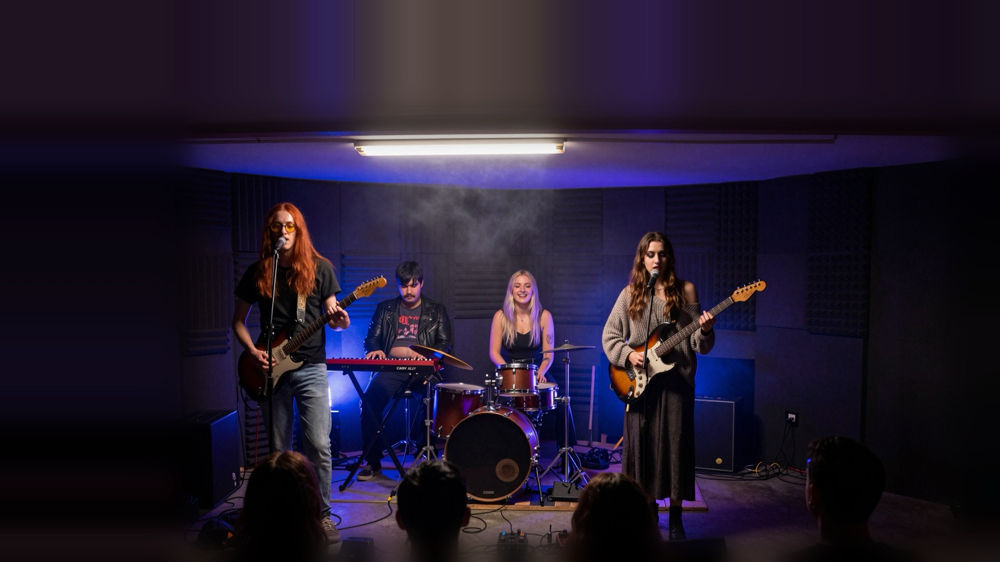

**Canny Alley** is a virtual Polish cold-wave band: four musicians, one garage, a lot of chorus pedal and
analog synths. Every song, voice, photo and video loop was generated **locally** with open models on two
home computers, and this repository releases everything needed to understand or reproduce it: the band
"bible" (looks, voices, wardrobe rules), every prompt, the lyrics, the settings and the scripts.

> A tak naprawdę to nie istniejemy. *(And to be honest, we don't exist.)*

**▶ Listen and watch: [youtube.com/@CannyAlley](https://www.youtube.com/@CannyAlley)** ·
[playlists](https://www.youtube.com/@CannyAlley/playlists)

---

## The band

<p>
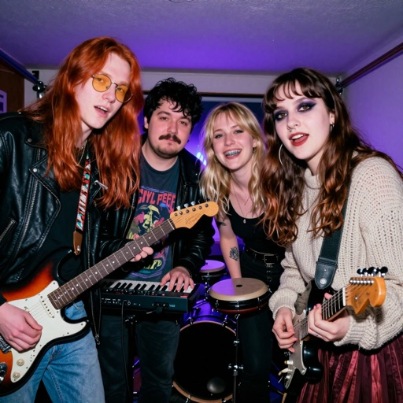
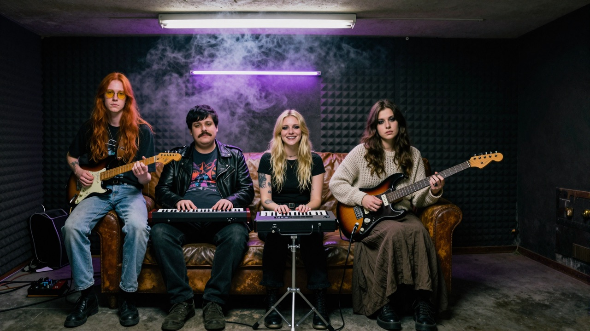
</p>

**Po polsku (the channel text):**

> Zaczęliśmy w zawilgoconym garażu na obrzeżach miasta – czwórka znajomych z jednego blokowiska, grająca po
> nocnych zmianach, bo na prawdziwą salę prób nie było nas stać. Szymon, nasz chudy, rudy wokalista i gitarzysta
> w żółtych okularach, śpiewa zdartym, ostrym głosem, który częściej krzyczy, niż prosi. Marta, nasza druga
> wokalistka i gitarzystka, odpowiada mu niskim, spokojnym i chłodnym głosem, a Ola zza elektronicznych bębnów
> dokłada wysokie, przejrzyste chórki, które unoszą się nad nami wszystkimi. Bartek w skórzanej kurtce i za
> krótkiej koszulce trzyma nas w ryzach syntezatorami, a raz na jakiś czas mruczy gdzieś w tle niskie, prawie
> mnisze chóry. Gramy polską zimną falę z gitarowym brudem i analogową elektroniką – o wynajmowanych
> mieszkaniach, nocnych zmianach, hejcie w sieci i szukaniu kogoś w tłumie, czyli o tym, jak się żyje, kiedy
> dorosłość przyszła bez pukania. A tak naprawdę to nie istniejemy.

**In English:** we started in a damp garage on the edge of town, four friends from the same housing estate
rehearsing after night shifts because a real rehearsal room was out of reach. We play Polish cold wave with
dirty guitars and analog electronics, about rented flats, night shifts, online hate and looking for someone in
the crowd — about life once adulthood walks in without knocking.

| | Member | Plays | Looks (fixed prompt block) | Voice (fixed caption block) |
|---|---|---|---|---|
| **R** | Szymon | lead vocals, electric guitar | tall, skinny, long straight ginger-red hair, slightly yellow-tinted round glasses | raspy, sharp, strained grunge voice "like Kurt Cobain", cracking on high notes |
| **D** | Marta | lead vocals, guitar, small synth | long brown hair, nose ring, lip piercing, dark smoky eye makeup; long skirt, loose knitted sweater | deep low contralto — calm, gloomy, cold, intimate |
| **B** | Ola | electronic drums, percussion pads, backing vocals | average-looking, fit, blonde, metal dental braces, small forearm tattoo | high, clear, airy soprano — sharp, crystalline, ethereal |
| **M** | Bartek | keyboards, analog synths, drum pads | short, plump, black hair, waxed moustache; black leather jacket, too-short band t-shirt showing a belly | rarely: a deep warm bass hum like a distant monk choir, always far in the background |

All four are "young adults in their twenties" in every prompt — not kids, not old men. The exact text blocks
are in [`band/band.json`](band/band.json).

<p>
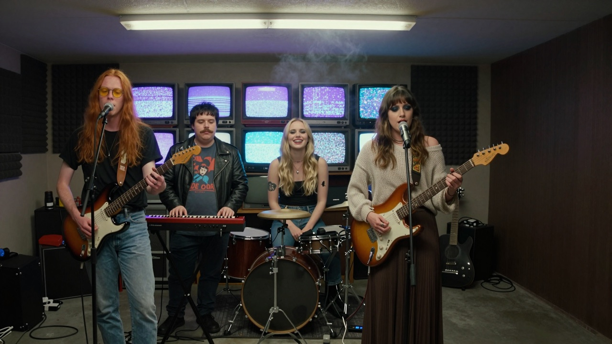
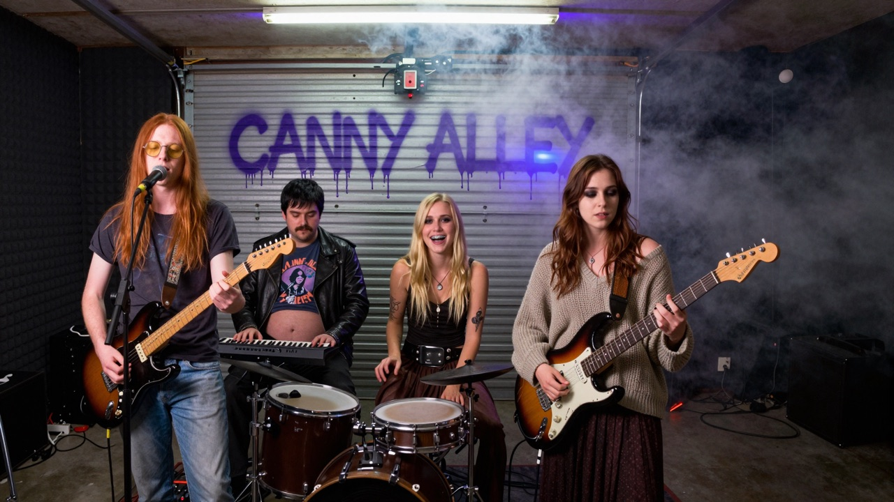
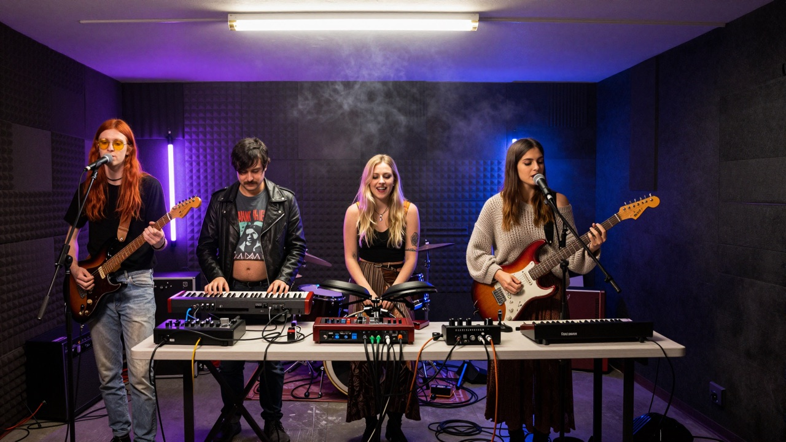
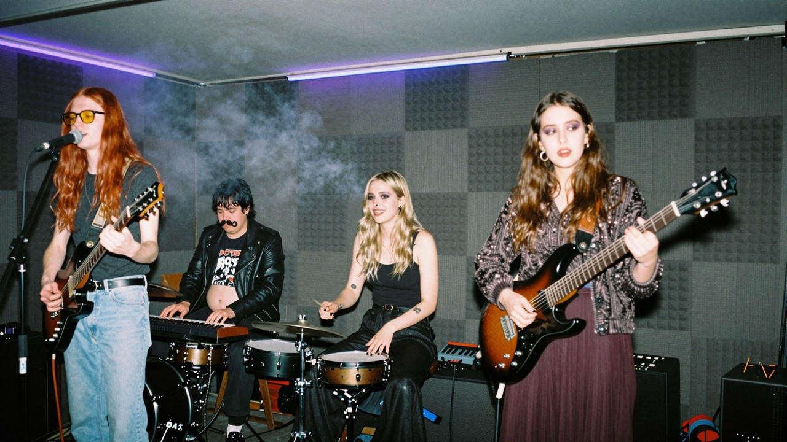
</p>

---

## Album: *Wynajęte życie* (Rented Life, 2026)

Fifteen songs about searching for love, depression, getting into adult life, a broken economy, rent you can
never stop paying, late shifts, online hate and wars. One coherent band sound (chorus-drenched guitars, driving
bass, live drums over a drum machine, analog synths) across deliberately different song forms: motorik,
shoegaze, noise rock, slowcore, a 3/4 waltz, punk, EBM-ish minimal synth, post-rock. Every key and tempo is
different; no piano anywhere; solos on guitar or synth; bridges, drops, slowdowns and climaxes instead of
verse-chorus loops. Lengths were drawn at random between 2:24 and 4:11.

| # | Title | Length | Style · key · BPM | Voices | Video |
|---|---|---|---|---|---|
| 1 | Wynajęte życie | 3:13 | driving post-punk, drop + noisy solo · E minor · 146 | R, D | [▶](https://youtu.be/QX8YRbuU4BQ) |
| 2 | Nocna zmiana | 4:01 | motorik krautrock, synth solo · A minor · 132 | D | [▶](https://youtu.be/rv6__W6mbL4) |
| 3 | Szukam cię w tłumie | 3:59 | shoegaze, wall-of-sound climax · D major · 96 | R, B | [▶](https://youtu.be/mPbzdN32KYc) |
| 4 | Komentarze | 2:54 | angular noise rock, spoken breakdown · F♯ minor · 172 | R, D | [▶](https://youtu.be/s3EuvVO9YN0) |
| 5 | Syreny | 3:54 | slow darkwave, distorted climax · C minor · 72 | D, B, M | [▶](https://youtu.be/fNmzz-mjkiY) |
| 6 | Dorosłość | 3:54 | jangly indie, key change · G major · 126 | R, D | [▶](https://youtu.be/wGv1MLB3g5w) |
| 7 | Kredyt na trzydzieści lat | 2:49 | minimal synth / EBM, drop · B minor · 118 | D, R | [▶](https://youtu.be/rkX9SdYlB8s) |
| 8 | Szklanka wody | 2:47 | slowcore, near-silence → swell · E♭ minor · 64 | D, B | [▶](https://youtu.be/Phbe3RBl8Zc) |
| 9 | Blok siódmy | 3:14 | trip-hop tinged, delay solo · A♭ major · 84 | R, D | [▶](https://youtu.be/5zCHFuJIVm4) |
| 10 | Ekran | 3:50 | glacial synth-pop, beat drop · C♯ minor · 112 | B, R | [▶](https://youtu.be/dSzMYuIKfk8) |
| 11 | Gruzy | 3:28 | industrial, half-time drop · B♭ minor · 100 | R | soon |
| 12 | Ostatni tramwaj | 3:14 | cold-wave waltz in 3/4 · F minor · 150 | R, D | soon |
| 13 | Pod prąd | 3:07 | fast punk, gang shouts · G minor · 178 | R + band | soon |
| 14 | Przetrwamy | 3:28 | anthem, soaring climax · D minor · 138 | all four | soon |
| 15 | Światło w oknie naprzeciwko | 4:08 | ambient → post-rock, long solo · B major · 70 | D, R, M | soon |

Lyrics: [`albums/wynajete-zycie/lyrics/`](albums/wynajete-zycie/lyrics/) (Polish, with section tags that name
the singer, e.g. `[Verse 2 - deep low female vocal]`). Captions, keys, tempos and durations:
[`albums/wynajete-zycie/album.json`](albums/wynajete-zycie/album.json).

**Song backgrounds** — every video shows band members inside the song's scene, dressed for the scene, never in
stage clothes; a calm 1080p loop where only light details, smoke, snow or breathing move; the last 6 seconds
fade to black, a band photo fades in and out.

<p>
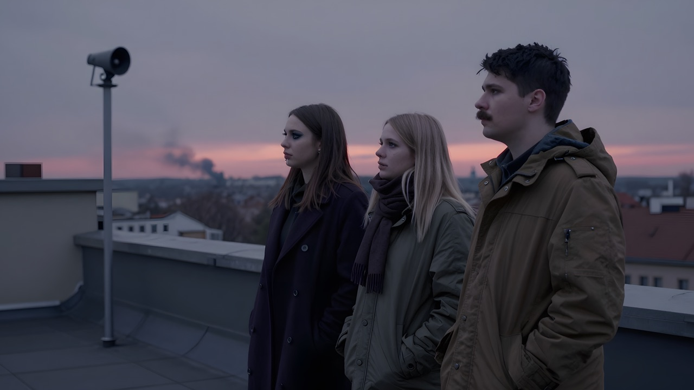
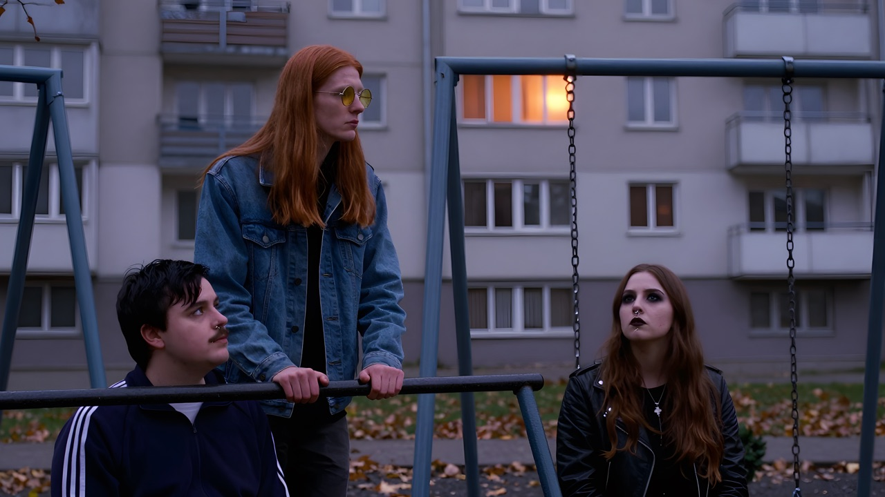
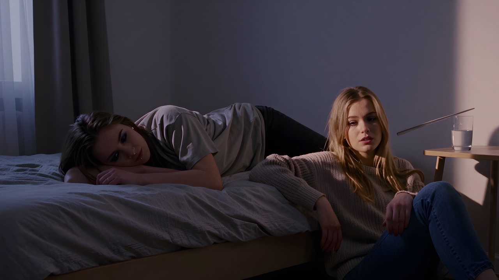
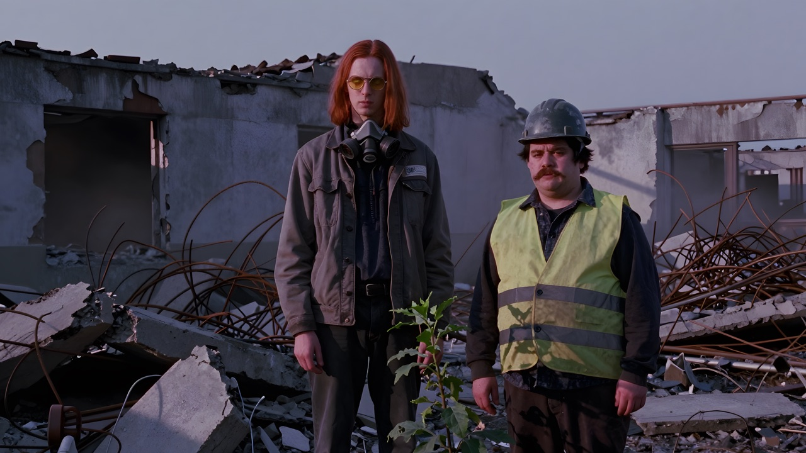
</p>

---

## How it was made

| Stage | Model / tool | Settings that mattered |
|---|---|---|
| Songs | **ACE-Step 1.5 XL turbo** (4B DiT) + **ACE-Step 5Hz LM 4B** | 8 steps, shift 3.0, fixed BPM + key per song, seed 1000+N, "thinking" on, CPU offload; ~2 min per song on an RTX 4070 SUPER 12 GB (XL does not fit a 24 GB Mac — the Mac fallback is ACE-Step 1.5 turbo 2B + LM 1.7B on MLX) |
| Band photos, channel art, backgrounds | **Z-Image Turbo 1.0** (6-bit, via the Draw Things CLI) | 8 steps (model default), ≤1536 px wide (2048 px works but loses detail); sizes must be multiples of 64 |
| Face detail pass | Z-Image img2img on 1024² face crops + **Apple Vision** face detection | strength 0.4–0.5 by face size, one fixed description per member so the same four faces stay recognisable; colour and grain matched back |
| Upscale | **Real-ESRGAN x4plus** (ncnn-vulkan) | backgrounds sharpened to 1920×1088 before animation |
| Video loops | **LTX-2.3 22B distilled** (Lightricks LTX-2, bf16 + fp8-cast, CPU offload; MLX q4 build on the Mac) | two-stage 960×544 → 1920×1088, 65 frames @ 24 fps, seed 7, cover anchored **at frame 0 only**; clip auto-trimmed before any brightness drift, then ping-pong looped |
| Assembly | ffmpeg | loop under the song, 6 s band-photo end card, AAC 256k, H.264 CRF 18 |

**Hardware:** Mac mini M4 (24 GB) for orchestration, covers and assembly; a Windows PC with an RTX 4070 SUPER
(12 GB) and 64 GB RAM for ACE-Step XL, LTX-2.3 at 1080p and Real-ESRGAN. The two machines exchanged job files
and results through a shared NAS folder; each LTX song was "claimed" by one machine before rendering.

**Lessons that cost the most time** (details in [`AGENTS.md`](AGENTS.md)):
- Anchoring LTX's **last** frame to the cover at any useful strength freezes the clip; anchor frame 0 only.
- Motion prompts that make **light change** ("flicker", "shimmer", "twinkle", headlights) make LTX fade to
  black. Describe people and objects moving and say the light stays the same. Dark covers fade more easily.
- Rendering LTX small (896×448) and upscaling 4× looks smeary; render natively at 1080p.
- Four voice descriptions in one caption blur together: use at most two voices in normal sections, the third
  only in bridges/climaxes, the background hum in a few songs.

---

## Repository layout

```
band/band.json                     members: names, roles, look, stage clothes, voice blocks, channel text
albums/wynajete-zycie/
  album.json                       base caption, voice blocks, per-song style/key/BPM/duration
  lyrics/NN-slug.txt               lyrics with singer-labelled section tags
  song-jobs/*.json                 exact ACE-Step GenerationParams used for every song
  backgrounds.json                 background prompts (members in scene clothes) + motion prompts
  ltx-hd-jobs/*.json               exact LTX-2.3 jobs (prompt, size, frames, seed, anchors)
  endcards.json                    which band photo closes which video
prompts/
  channel-concepts.json            the overnight banner/avatar concept batch (12 banner + 8 avatar scenes)
  band-photos-winter-live.json     winter park session + concert photo prompts
  face_labels.json                 which detected face is which member (face pass)
scripts/                           the pipeline as it ran (see AGENTS.md for the original directory layout)
images/                            a random selection of the generated photos and backgrounds
AGENTS.md                          how an agent (or a human) reproduces the band and an album
```

Model weights, rendered audio and full-size video are **not** included.

## Licence

Everything in this repository — scripts, prompts, lyrics, band descriptions and the included images — is
released under the **GNU General Public License v3.0** ([LICENSE](LICENSE)). The models used are not part of
this repository and come with their own licences (ACE-Step 1.5, Z-Image Turbo, LTX-2.3, Real-ESRGAN, Draw
Things); check each upstream project before reusing their weights or outputs.

All music, voices and images here are AI-generated. Canny Alley is fictional; any resemblance to real people is
unintended.
